# EasyCircular User Manual

Version 1.0 · August 2026

Ministry circulars are long. EasyCircular is a website that pulls out the useful bits — what the circular is about, who it is for, and what the school has to do — so you are not hunting through twenty pages before morning assembly.

**Please treat the original PDF as the real circular.** The summary is a shortcut. If a date or a circular number looks off, open the PDF and check.

---

## Contents

1. [What this is](#1-what-this-is)
2. [What you need](#2-what-you-need)
3. [The usual path](#3-the-usual-path)
4. [Accounts](#4-accounts)
5. [Home](#5-home)
6. [Uploading a PDF](#6-uploading-a-pdf)
7. [Checking the text](#7-checking-the-text)
8. [The summary](#8-the-summary)
9. [Coloured labels in the text](#9-coloured-labels-in-the-text)
10. [Saving and translating](#10-saving-and-translating)
11. [Library](#11-library)
12. [Official catalog](#12-official-catalog)
13. [On a phone](#13-on-a-phone)
14. [Those little status labels](#14-those-little-status-labels)
15. [When something goes wrong](#15-when-something-goes-wrong)

---

## 1. What this is

If you work in a school and you get MOE circulars as PDFs, this is for you. You either drop in a file you already have, or you pull one from the ministry site. The system reads the pages (including scans in English, Sinhala, or Tamil), shows you the text, and then writes a short brief.

You still have to look at that text before the summary runs. That is on purpose. OCR misreads names. Scans pick up stamps. Better you catch it than the summary invent a deadline.

After that you can copy the brief, download it as a PDF, or switch it to Sinhala or Tamil if the original was in English (and the other way round).

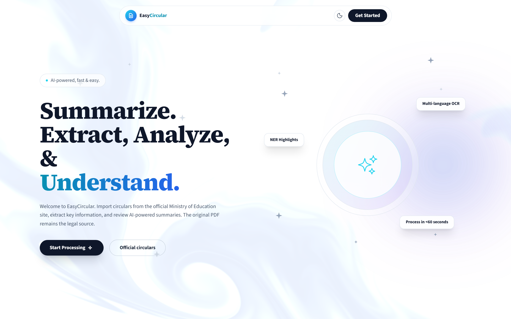

*Figure 1. The home page. Use **Start Processing** if you have a file, or **Official circulars** if you want the ministry list.*

---

## 2. What you need

Chrome, Edge, Firefox, or Safari is fine. You need an account — email and a password, or Google. The file has to be a real PDF, not bigger than 50 MB.

You can look around without signing in. You cannot upload or import until you do.

Keep the original circular. EasyCircular does not replace it, and it does not send anything to the Ministry on your behalf.

---

## 3. The usual path

Along the top of a document you will see four steps: **Upload**, **Extract**, **Review**, **Summarize**. That is the whole job, in order.

1. Sign in and put a PDF in (or import one from the catalog).
2. Wait while the text comes out. Scanned pages take longer.
3. Open **Editor**, fix anything wrong, **Save edits**, then **Text is correct**.
4. Hit **Generate summary** and read what comes back.

The two things worth checking by hand are the circular number and the dates. Staff act on those.

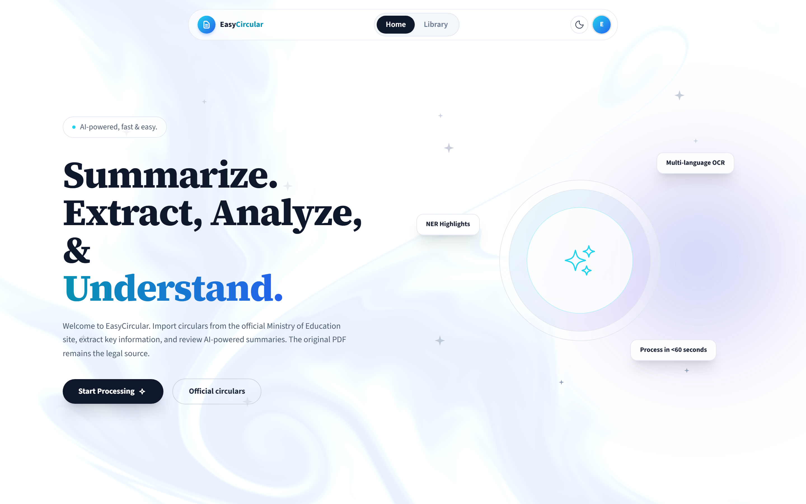

*Figure 2. Once you are signed in, the upload box is available.*

---

## 4. Accounts

**New account.** Click **Get Started** or **Sign up**. You will be asked for your name, email, a password of at least eight characters, and your job role (Teacher, Principal, or Education administration). District is optional; type a few letters and pick from the list.

**Create account**, or **Continue with Google** if that is easier. After that you land back at upload.

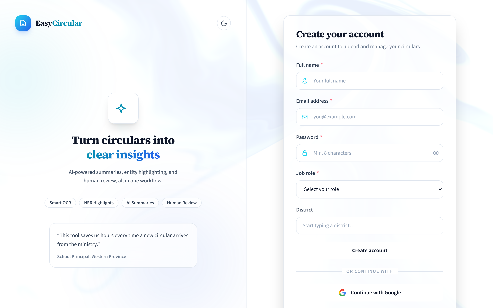

*Figure 3. Sign-up form.*

**Coming back.** Use **Sign in**. Same email and password, or Google again. **Remember me** is there if you want it.

There is a **Forgot password?** link. It does not actually reset anything yet. If you are stuck, try Google, or get someone to make a new account.

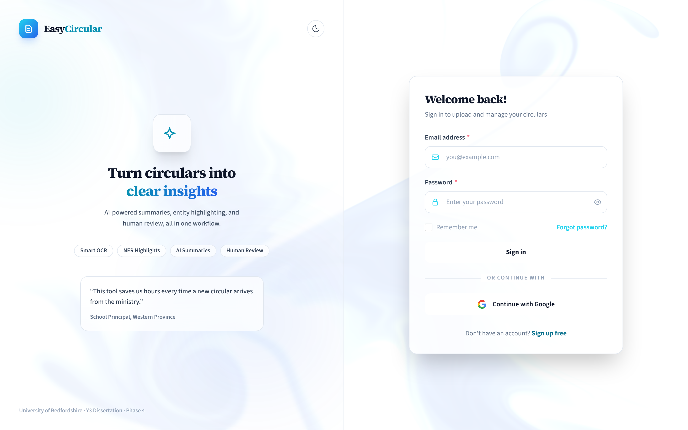

*Figure 4. Sign-in.*

**Sign out** is in the top bar on the home page, and in the left sidebar once you are in a document.

---

## 5. Home

This is the first screen. The dark **Start Processing** button takes you to upload (it will send you to sign in if you have not). **Official circulars** opens the moe.gov.lk list inside EasyCircular.

**Get Started** is sign in / sign up. The moon (or sun) icon switches dark mode. **Library** is your own files.

The four cards under the fold are just a description of the product. You do not click them to do the work.

---

## 6. Uploading a PDF

If you are not signed in, the box says **Sign in to upload**. Fair enough.

From home, scroll down to the drop area, or once you are in the workspace use **New Analysis** on the left.

Drop the file, or click to browse. You should see **Uploading your circular…**, then the document screen opens.

A few limits that catch people:

- It has to be a PDF. Renaming a Word file to `.pdf` will not work.
- 50 MB is the ceiling.
- One file at a time. There is no “upload this whole folder” button.

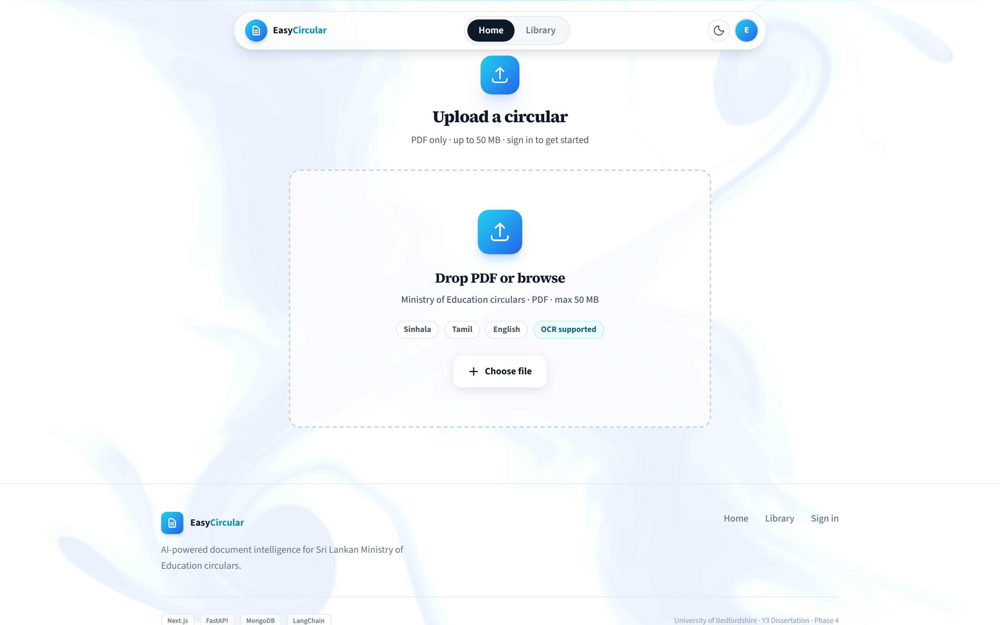

*Figure 5. The upload box on the home page.*

---

## 7. Checking the text

Extraction usually starts on its own. If it does not, use **Extract text**. **Re-extract** runs it again if the first pass looked empty or garbled.

Sinhala and Tamil scans can sit there for a while. Leave the tab open.

You cannot generate a summary until you have said the text is all right. That is the **Review** step.

Open **Source text**. **Editor** is where you type. **Highlights** shows coloured tags later, after a summary exists.

Correct the obvious stuff: circular number, dates, school names, anything OCR mangled in Sinhala or Tamil. **Save edits** (that also counts as reviewed). Then **Text is correct**, then **Generate summary**.

The text on screen is a working copy. The PDF is still the circular.

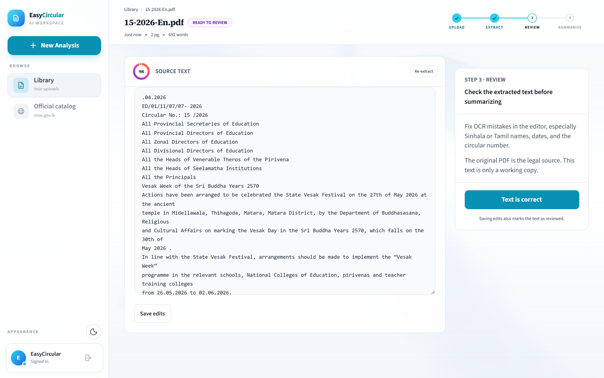

*Figure 6. Review. Read the text, then confirm it before you summarise.*

---

## 8. The summary

**Generate summary** shows **Building brief…** for a bit. What you get is a title, the number, who issued it, who it is for, when it takes effect, a purpose, the main requirements, **Action items**, and sometimes **Key references**.

Along the top of that panel:

- **Edit** — change the wording, then **Save changes** or **Cancel**. You can only edit the original language, not a translation.
- **Copy** — puts it on the clipboard.
- **Export** — downloads a PDF of the brief (not the original circular).
- **Regenerate** — runs it again from the text you have now.
- The language tabs — English / සිංහල / தமிழ், depending on the source.

There is a small disclaimer on every brief. Read it. The model can skip things or make things up.

If the file came from the catalog, **Open on moe.gov.lk** is a link back to the ministry page. Use it.

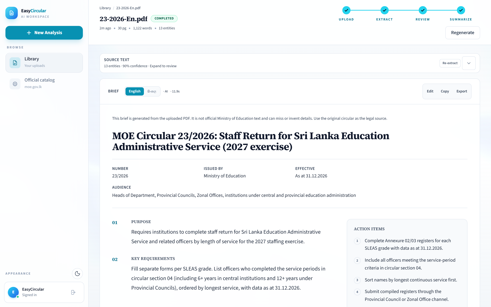

*Figure 7. A finished brief. Action items are on the right.*

Sometimes the summary is not a full AI write-up:

| You will see | What happened | Sensible next step |
| --- | --- | --- |
| **AI summary unavailable** | The model did not run. You get a plainer extract instead. | Try **Regenerate** in a few minutes. |
| **Review suggested** | The system thought a date was invented, or two circulars got mixed. | Open the PDF. Do not act on the brief yet. |
| **Unreadable brief** | The text came out as a mix of scripts. | **Regenerate**. |

---

## 9. Coloured labels in the text

After a summary, expand **Source text** and switch to **Highlights**. Dates, organisations, people, and legal-looking phrases are marked. You might see something like “13 entities · 90% confidence” on the bar. Treat that as a hint, not a score you report to anyone.

| Colour | Tag | Usually |
| --- | --- | --- |
| Yellow / amber | DATE | Deadlines and issue dates |
| Blue | ORG | Ministry, a school, a provincial office |
| Pink | PERSON | A name on the letter |
| Teal | LAW | Circular numbers, acts |
| Grey | OTHER | Anything else it tagged |

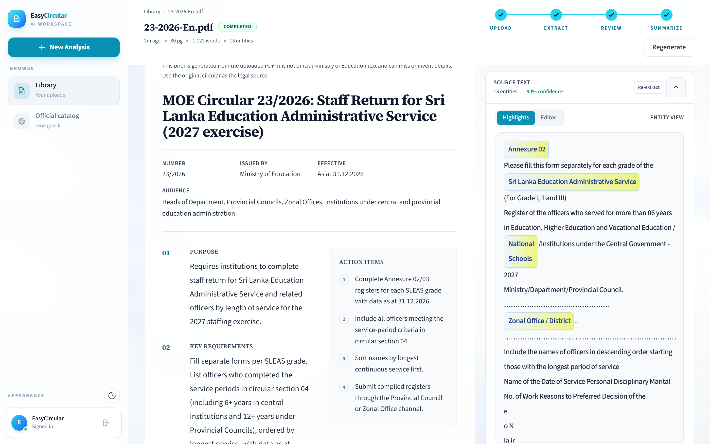

*Figure 8. Highlights on the source text.*

---

## 10. Saving and translating

**Export** is on the brief toolbar. That PDF is the summary, for a staff meeting or an email. If you only need a paste, use **Copy**.

The language tabs are on the left of the same toolbar. English circulars usually offer Sinhala as well. A Sinhala or Tamil original will offer English. Click the tab and wait for **Translating brief…**.

A translation is for sharing with staff. It is not more official than the circular you uploaded.

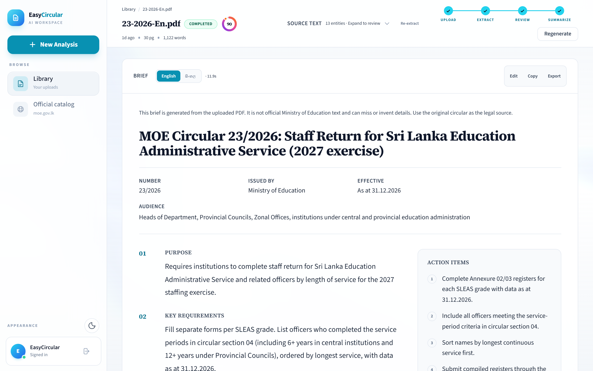

*Figure 9. Language tabs, Edit, Copy, Export.*

---

## 11. Library

**Library** in the sidebar (or from home) is your pile of work. Uploads and catalog imports both land here.

The switch at the top is **Your library** versus **Official catalog**. On your library you can filter **All**, **Summarized**, or **In progress**, and you can search by file name or a bit of the summary.

Click a card to open it. Each card shows how old it is, pages, words, and how many tags it found. Imports from the ministry are marked **Official moe.gov.lk**.

Delete is on the card. It asks once. After that the file is gone.

If you are not signed in you can still see the layout, but you will be asked to sign in before anything is saved against you.

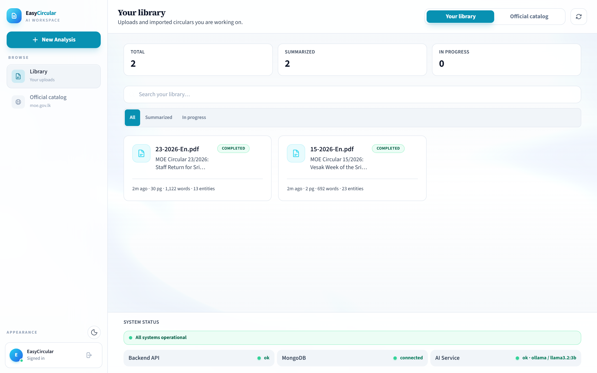

*Figure 10. Library.*

---

## 12. Official catalog

This is the list from [moe.gov.lk](https://moe.gov.lk/en/circulars/), shown inside EasyCircular. Importing a PDF does not mean EasyCircular is the ministry. The summary is still made here, from that file.

Open **Official catalog** (home has **Official circulars** as well). Search. On an entry, open **PDFs**, then **Import**. If you are not signed in it will say **Sign in to import**.

**Importing…** takes a moment. After that it is the same as an upload: extract, review, summarise.

**Previous** and **Next** move through the list.

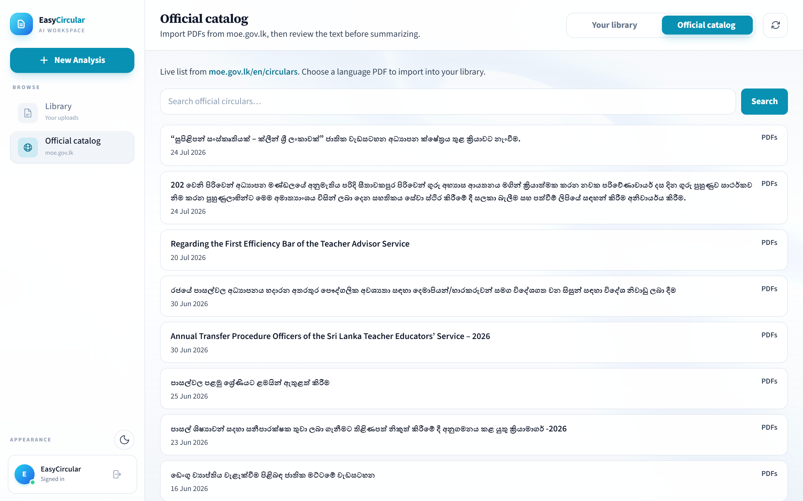

*Figure 11. Catalog search and import.*

---

## 13. On a phone

It works in the phone browser with the same login. Buttons stack. **New Analysis** is still how you upload.

If you are going to sit and correct a long Sinhala scan, a laptop is less painful.

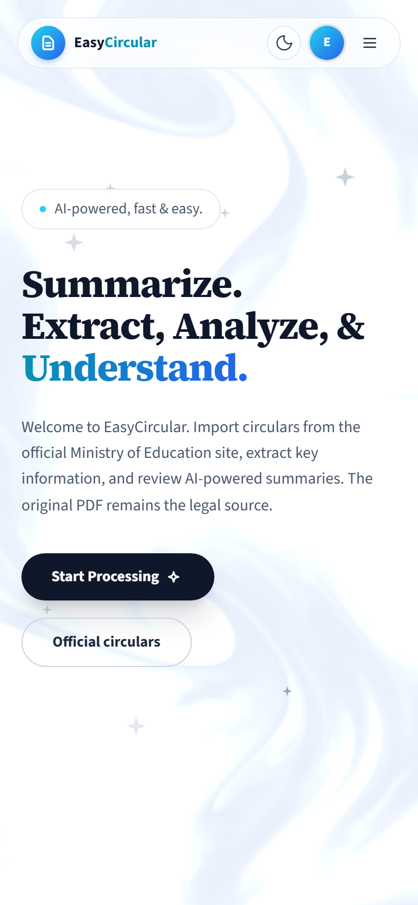

*Figure 12. Home on a phone.*

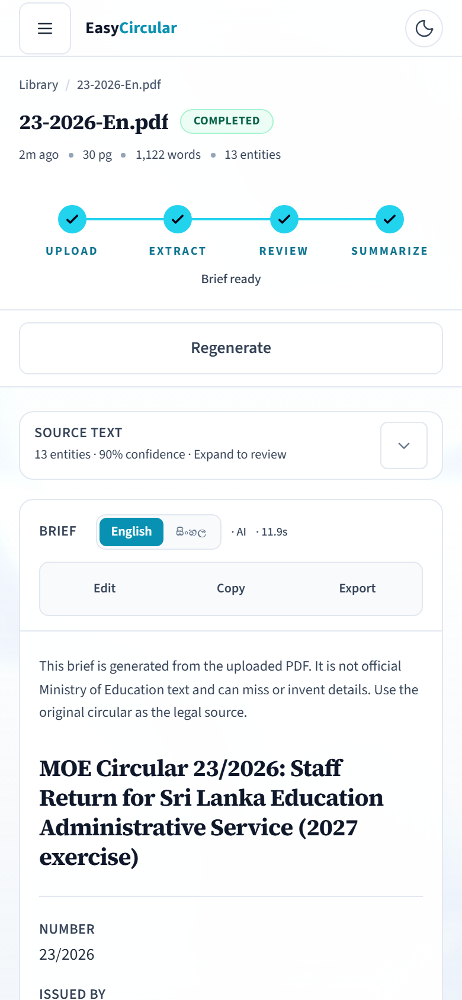

*Figure 13. A brief on a phone.*

---

## 14. Those little status labels

| Label | Colour | Meaning |
| --- | --- | --- |
| **Uploaded** | Cyan | File is in. Text not out yet. |
| **Ready to review** | Purple | Text is there. You still have to check it. |
| **Processing** | Amber | Summary is running. |
| **Completed** | Green | Brief is ready. |
| **Failed** | Red | It broke. **Try again** or **Retry**. |

---

## 15. When something goes wrong

Check the circular number and the dates first. If those are wrong, fix them in the editor and regenerate.

Prefer **Official catalog** when you can, so you are not working from a photocopy someone emailed last year.

**Export** once you are happy, and file that PDF with the original circular.

| Problem | Try this |
| --- | --- |
| **Sign in to upload** | You are not logged in. |
| File rejected | It is not a real PDF, or it is over 50 MB. |
| Blank or messy text | Wait, then **Re-extract**. Edit what you can. |
| Summary is nonsense | Fix the source, **Save edits**, **Regenerate**. |
| **AI summary unavailable** | The model is down or busy. Try later. |
| **Forgot password?** | Does not work. Use Google, or a password you still know. |
| A long scan is slow | That is normal. Do not close the tab. |

EasyCircular will not email the Ministry for you, will not file your staff return, and will not take a whole folder of PDFs in one go. If a date matters, read it in the original circular.

The home page has a **System Status** strip. If that looks unhealthy, the summary may fail until someone brings the services back up.
